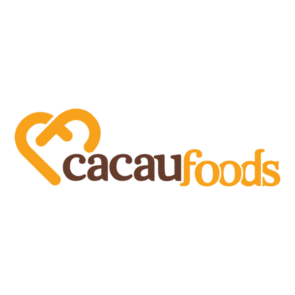
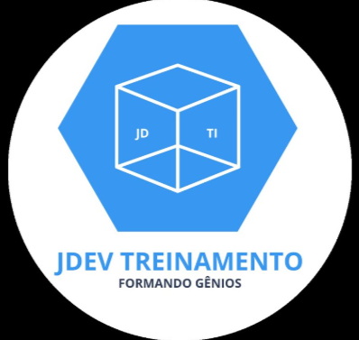

### Olá! Sou o Dan Vasques 👋  

:computer: Desenvolvedor e Analista de Sistemas Full Stack  

Atuo com **ADVPL no ERP TOTVS Protheus**, **integrações via API REST** e **SQL Server**, com entregas de ponta a ponta (requisitos → desenvolvimento → homologação → produção). Possuo base em **Java e Spring Boot**.  

📧 Contate-me por e-mail: dan.vasques@outlook.com.br  
💼 Contate-me por LinkedIn: https://www.linkedin.com/in/dan-vasques-carvalho/

  

  <em>🖥️ Stacks</em>

    
    
    
    
    
    
    
    
    
    
    
    
    
    
    
    
    

 

**Linguagens:** `Java` `ADVPL` `SQL` `Python` `JavaScript` \
**Back-end e APIs:** `Spring Boot` `Spring Data JPA` `Spring Security` `Hibernate` `Maven` `API REST` `JSON` `XML` `MVC` `POO` \
**ERP:** `TOTVS Protheus` `TOTVS SFA` `TOTVS Transmite` `T-Cloud` \
**Banco de dados:** `SQL Server` `MySQL` \
**Front-end:** `HTML5` `CSS3` `JavaScript` \
**Ferramentas:** `Git` `GitHub` `SVN` `Postman` `IntelliJ IDEA` `Eclipse` `VS Code` `Linux` `Kanban` `Trello` `Notion`

 

## Experiência Profissional

[**Analista de Sistemas Jr**](https://www.linkedin.com/in/dan-vasques-carvalho/) \
Cacau Foods do Brasil\
Julho de 2026 - o momento \
`ERP TOTVS Protheus`, `ADVPL`, `API REST`, `JSON`, `VS Code`, `SQL Server`, `SVN`, `T-Cloud`

 

[**Analista de Suporte Técnico em TI**](https://www.linkedin.com/in/dan-vasques-carvalho/) \
Secretaria da Educação do Estado de São Paulo\
Março de 2023 - Julho de 2026 \
`Suporte Técnico N1/N2`, `Troubleshooting`, `Documentação Técnica`, `M365`, `Google Workspace`

 

## Projetos

[**Vasques Tech**](https://github.com/danvasquesc/vasques-tech) · [Demo](https://danvasquesc.github.io/vasques-tech) \
Site responsivo de serviços de manutenção e suporte de notebooks, com canal direto para orçamentos via WhatsApp \
`HTML5`, `CSS3`, `JavaScript`, `Git`, `VS Code`, `GitHub Pages`

 

[**Práticas em Java**](https://github.com/danvasquesc/exercicios_java) \
Fundamentos de back-end e Programação Orientada a Objetos \
`Java`, `POO`, `IntelliJ IDEA`, `Git`

 

[**Capacitador e Instrutor em Iniciação Tecnológica**](https://www.linkedin.com/in/dan-vasques-carvalho/) \
Secretaria da Educação do Estado de São Paulo\
Agosto de 2025 - Novembro de 2025 \
`Python`, `Lógica de Programação`, `Estrutura de Dados`, `Git`, `GitHub`, `Banco de Dados SQL`, `Hardware`

 

## Formação acadêmica

**Análise e Desenvolvimento de Sistemas**\
UNIMAR - Universidade de Marília \
Abril de 2024 - Dezembro de 2026

**Licenciatura em Ciências Sociais**\
UNESP - Universidade Estadual Paulista \
Fevereiro de 2019 - Fevereiro de 2024

 

## Formação Complementar

**Formação em Arquitetura de Sistemas (Java, Spring Boot, APIs REST, MVC)**\
QualificaSP (120h) · 2026

**Formação em Aplicação de Banco de Dados SQL (SQL, MySQL, Power BI)**\
QualificaSP (120h) · 2026

**Certificado em Privacidade e Proteção de Dados Pessoais (LGPD)**\
DPOnet · 2025

**Git e GitHub: Versionamento de Código**\
JDev Treinamento · 2024

**Minicurso de Inglês Básico**\
Universidade de Marília · 2024

**Minicurso de Gestão de Tempo**\
Universidade de Marília · 2024

 

#### Feito por [Dan!](https://github.com/danvasquesc) ✨
